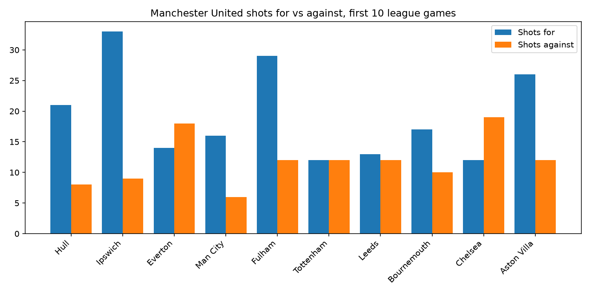
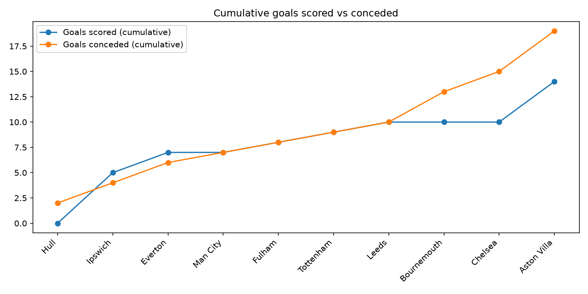

# Manager change analysis: Manchester United, 2026-27

Manchester United sacked Michael Carrick on 12 November 2026 after 10 league games and appointed Mauricio Pochettino. This project looks at whether the team's numbers change under the new manager, and by how much.

## Method

- **Baseline:** Carrick's 10 Premier League games this season (22 Aug to 8 Nov), saved as `carrick_era_clean.csv` and not edited afterwards.
- **Comparison:** Pochettino's games, added to a separate file after each match and cleaned the same way.
- **Metrics:** goals, shots, shots on target, corners, fouls and points, with home and away splits. Every figure is from United's side, shown as "for" and "against".

## Carrick baseline

| | |
|---|---|
| Record | 1 win, 5 draws, 4 defeats (8 points) |
| Goals for / against | 14 / 19 |
| Shots per game for / against | 19.3 / 11.8 |
| Shots on target per game for / against | 5.4 / 5.1 |

United had more shots than their opponents in 7 of the 10 games but still conceded more than they scored. Shot counts can't say whether that comes from finishing, shot quality or defensive mistakes. Expected goals (xG) would help separate them, and it's the next thing I want to add.

## Limitations

- Ten games is a small sample, and the Pochettino sample will be small for a while. Early differences may just be noise.
- No xG yet. My first attempt at an xG source failed, so I'm looking for another one.
- Fixture difficulty isn't adjusted for.

## Data

Match results and shot counts from football-data.co.uk.

## Files

- `01_data_check.ipynb`: loading, cleaning, charts
- `carrick_era_clean.csv`: cleaned baseline data
- `shots_for_vs_against.png`, `cumulative_goals.png`: charts

## Status

Baseline complete. Pochettino's games will be added once their data is available.